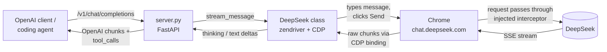

<div align="center">

# 🐋 OpenSeek

**Use the DeepSeek web chat as an OpenAI-compatible API, with no API key needed.**

Point the OpenAI SDK, a coding agent or any OpenAI-style client at `http://localhost:8888/v1`.
Streaming, DeepThink reasoning, web search, deep research, tool calling and file attachments all work.

[](https://www.python.org/)
[](LICENSE)
[](#-openai-compatible-server)
[](#-run-with-docker)

[Quick start](#-quick-start) · [Server](#-openai-compatible-server) · [Python library](#-python-library) · [How it works](#-how-it-works) · [Configuration](#%EF%B8%8F-configuration)

</div>

---

## ✨ Why OpenSeek?

- 🔑 **No API key or billing.** It uses the free DeepSeek account you already have.
- 🔌 **Drop-in OpenAI API.** `/v1/chat/completions` and `/v1/models`, so existing tools work with only a base-URL change.
- 🧠 **DeepThink reasoning.** Pick the `deepseek-reasoner` model and the reasoning streams back as `reasoning_content`.
- 🛠️ **Tool calling.** `tools` / `tool_calls` work, so coding agents can read files, run commands and loop.
- 🌐 **Web search.** Send `"search": true` to ground answers in DeepSeek's live search results.
- 🔬 **Deep research.** The `deepseek-research` model plans the research, runs each search step and writes a cited report.
- 📎 **Attachments.** Images, PDFs, Office documents and code files, up to 50 files per message.
- ⚡ **Real streaming.** Tokens come from DeepSeek's own response stream, not from scraping the page, so the output is the model's raw Markdown.
- 💬 **Conversation memory.** Each conversation maps to a DeepSeek chat. opencode sessions are tracked by session ID and can be saved across restarts; other conversations are replayed into a new chat after a restart.
- 🐳 **One-command deploy.** `docker compose up` brings up Chrome, Xvfb and the server.

## 🚀 Quick start

### 1. Get your DeepSeek token

Log in at [chat.deepseek.com](https://chat.deepseek.com), open the developer console (F12) and run:

```js
JSON.parse(localStorage.userToken).value
```

Using the token skips the email verification step that can block password logins.

### 2. Start the server

```bash
git clone https://github.com/paulerrr/OpenSeek.git && cd OpenSeek
pip install . fastapi uvicorn
DEEPSEEK_TOKEN=<your-token> python server.py
```

### 3. Call it like OpenAI

```python
from openai import OpenAI

client = OpenAI(base_url="http://localhost:8888/v1", api_key="anything")

stream = client.chat.completions.create(
    model="deepseek-chat",  # or "deepseek-reasoner" for DeepThink
    messages=[{"role": "user", "content": "Write a haiku about whales"}],
    stream=True,
)
for chunk in stream:
    print(chunk.choices[0].delta.content or "", end="")
```

Or with `curl`:

```bash
curl http://localhost:8888/v1/chat/completions \
  -H "Content-Type: application/json" \
  -d '{"model": "deepseek-chat", "messages": [{"role": "user", "content": "Hello!"}]}'
```

## 🐳 Run with Docker

```bash
cp .env.example .env   # fill in DEEPSEEK_TOKEN
docker compose up -d
```

The image includes Chromium and Xvfb, so the host doesn't need a display or a browser.

## 🔌 OpenAI-compatible server

| Endpoint                    | Description                               |
|-----------------------------|-------------------------------------------|
| `POST /v1/chat/completions` | Chat completions, streaming or not        |
| `GET /v1/models`            | Lists `deepseek-chat`, `deepseek-reasoner` and `deepseek-research` |
| `GET /health`               | Session status                            |

**Request options**

- `model`: `deepseek-reasoner`, or any name containing `think`, turns on DeepThink. You can also send `"deepthink": true`.
- `"search": true` turns on DeepSeek's web search for that turn.
- `deepseek-research`, or any model name containing `research`, runs deep research. You can also send
  `"deepresearch": true`. DeepSeek's web chat has no research mode of its own (the DeepResearch button some users
  see comes from the Better DeepSeek extension), so OpenSeek runs the loop itself, in one DeepSeek chat: a turn that
  writes a research plan, one turn per step (a DeepSeek web search, or a page OpenSeek downloads and attaches) and a
  turn that writes the report. The plan and each step's findings stream back as `reasoning_content` and the report as
  `content`. Plans are capped at 6 steps, a failed step is skipped, and tool calling is off for these requests. A run
  takes several minutes; other requests still get the browser between its turns. DeepThink applies to every turn when
  it's turned on with `"deepthink": true`.
- `system` / `developer` messages become a hidden system prompt. It goes into the request payload and is never typed into the chat. It comes after OpenSeek's default instructions (`openseek/internal/prompt.py`), which teach the model the tool-calling, history-replay and attachment formats.
- `tools` and `tool_choice` work through a prompt protocol. The tools are described to the model, and the `<tool_call>` blocks it writes (or DeepSeek's native DSML markup) come back as standard `tool_calls`. A bare `{"name": ..., "arguments": ...}` object on its own line, outside a code fence and naming one of the request's tools, counts as a call too, since the model sometimes drops the tags. Send results back as `tool` messages, as usual.
- Tool-call parsing also handles standalone DSML `invoke` blocks without a `calls` wrapper, an extra slash in an `invoke` opening tag, and JSON calls followed by stray DSML closing tags. These forms become executable tool calls in both streaming and non-streaming responses; recognized call markup is removed from the displayed answer. Invalid blocks remain visible as text.
- Mixed tool-call output with `</call-tool>` or a missing closing tag before a DSML calls wrapper is also accepted,
  and so is a `<tool_call>` JSON call closed by a DSML `invoke` / `calls` tag or followed directly by a DSML `invoke`. A stray empty DSML opener at the end is removed only after a valid call; unknown tool names and invalid JSON blocks stay visible as text.
- Attachments: `image_url` parts (data URLs or http(s) URLs) and `file` parts (`file_data` + `filename`), up to 50 files of 100 MB each.

**Streaming behavior**

- While a request waits its turn for the browser, the stream sends a `: keepalive` comment every 15 seconds, so clients don't time it out.
- Failures arrive as an `{"error": {...}}` event with a status-like `code`: `504` when DeepSeek doesn't answer within `OPENSEEK_TIMEOUT`, `503` when DeepSeek is busy or returns an error, and `400` when an attachment can't be uploaded.

### Use it with coding agents

Any agent that accepts a custom OpenAI base URL works.

**opencode:** add OpenSeek as a provider in `opencode.json`:

```json
{
  "provider": {
    "openseek": {
      "npm": "@ai-sdk/openai-compatible",
      "name": "OpenSeek",
      "options": { "baseURL": "http://localhost:8888/v1", "apiKey": "dummy" },
      "models": {
        "deepseek-chat": { "tool_call": true, "attachment": true, "limit": { "context": 128000, "output": 8192 } },
        "deepseek-reasoner": { "tool_call": true, "reasoning": true, "attachment": true, "limit": { "context": 128000, "output": 8192 } }
      }
    }
  },
  "model": "openseek/deepseek-chat"
}
```

Each opencode session (and each subagent session) gets its own DeepSeek chat, found by the `x-opencode-session-id`
header that opencode sends. A turn sends only the messages the chat doesn't have yet. Reverting or editing a message
replays the conversation into a new chat. Set `OPENSEEK_STATE_FILE` (or `OPENSEEK_USER_DATA_DIR`) to keep sessions
across server restarts.

Setting `limit.context` lets opencode compact long sessions automatically. The summary is written in the session's
existing chat, so the long history isn't sent again, and the compacted session then starts a fresh DeepSeek chat,
which keeps DeepSeek's own chat from getting too long. opencode's session-title requests are answered by the server
from your first message, without using the browser (`OPENSEEK_LOCAL_TITLES=0` sends them to DeepSeek).

**openclaude:**

```bash
bun run profile:init -- --provider openai --model deepseek-chat \
    --base-url http://localhost:8888/v1 --api-key dummy
```

## 🐍 Python library

You can also drive DeepSeek directly from Python, without the server.

```python
import asyncio
from openseek import DeepSeek


async def main():
    async with DeepSeek(token="<your-token>") as api:
        response = await api.send_message("Tell me about quantum physics", deepthink=True)
        print(response.deepthink_content)
        print(response.text)


asyncio.run(main())
```

<details>
<summary><b>Streaming</b></summary>

```python
async for event in api.stream_message("Explain tides", deepthink=True):
    if event.type == "thinking":
        print(event.content, end="")   # DeepThink reasoning
    elif event.type == "text":
        print(event.content, end="")   # the answer
    elif event.type == "done":
        response = event.response      # the complete Response
```

</details>

<details>
<summary><b>Synchronous usage</b></summary>

```python
from openseek import DeepSeek

api = DeepSeek(token="<your-token>")
try:
    api.initialize_sync()
    print(api.send_message_sync("Tell me about quantum physics").text)
finally:
    api.close_sync()
```

</details>

<details>
<summary><b><code>DeepSeek(...)</code> parameters</b></summary>

| Parameter         | Type          | Default | Description                                         |
|-------------------|---------------|---------|-----------------------------------------------------|
| token             | `str \| None` | None    | User token; skips the login form and email verification |
| email             | `str \| None` | None    | Email for logging in to DeepSeek                    |
| password          | `str \| None` | None    | Password for logging in to DeepSeek                 |
| user_data_dir     | `str \| None` | None    | Persistent Chrome profile, so the login survives restarts |
| headless          | `bool`        | True    | Launch the browser in headless mode                 |
| verbose           | `bool`        | False   | Enable detailed logging                             |
| chrome_args       | `list \| None`| None    | Additional arguments for Chrome                     |
| attempt_cf_bypass | `bool`        | True    | Attempt to bypass Cloudflare protection             |

</details>

<details>
<summary><b><code>send_message(...)</code> / <code>stream_message(...)</code> parameters</b></summary>

| Parameter       | Type    | Default | Description                                     |
|-----------------|---------|---------|-------------------------------------------------|
| message         | `str`   | -       | Message text to send                            |
| deepthink       | `bool`  | False   | Turn on DeepThink                               |
| search          | `bool`  | False   | Turn on web search                              |
| system_prompt   | `str`   | None    | Hidden instructions sent with the message       |
| files           | `list`  | None    | Paths of files to attach (images, documents...) |
| chat_id         | `str`   | None    | ID of an existing chat to continue              |
| timeout         | `int`   | 60      | Maximum time to wait for the response, in seconds |
| slow_mode       | `bool`  | False   | Type the message character by character         |
| slow_mode_delay | `float` | 0.25    | Delay between characters in slow mode           |

The returned `Response` has `text`, `chat_id`, `deepthink_content`, `deepthink_duration`, `search_results`,
`message_id` and `token_usage`.

</details>

<details>
<summary><b>Exceptions</b></summary>

- `MissingCredentials`: no token, and no email and password, were given
- `VerificationRequired`: DeepSeek asked for email verification during password login
- `InvalidCredentials`: the login failed
- `FileUploadError`: an attachment is missing, has an unsupported type, or failed to process
- `ServerDown`: DeepSeek is busy or returned an error
- `MissingInitialization`: dependencies are missing, or `initialize()` wasn't called

</details>

## 🔍 How it works



1. OpenSeek drives a real Chrome session with [zendriver](https://pypi.org/project/zendriver/) and logs in with your token or password.
2. A small script is injected before DeepSeek's own code runs. It wraps `fetch` / `XMLHttpRequest`, so when a message is sent it can add the hidden system prompt and DeepThink/Search flags to the request payload.
3. The raw response stream is forwarded to Python through a CDP binding. There, DeepSeek's JSON-patch events are rebuilt into reasoning and answer text.
4. The server converts that text into OpenAI-format responses, and parses `<tool_call>` blocks into `tool_calls`.

Requests share one browser tab, so they are processed one at a time. opencode sessions are matched to their DeepSeek
chat by session ID, and other conversations by a fingerprint of their messages, so a follow-up turn only sends the new
messages.

Session matching preserves message whitespace and tool names and arguments, so edits to code or tool calls
start a fresh chat with the corrected history. Streaming sessions remember the exact text delivered to the client.
The first continuation of a session saved by an older version may replay its history once to adopt the new fingerprints.
Session-ID tracking, local titles, compaction handling, persistent mappings, and streaming keepalives remain enabled.

Malformed tool-call blocks remain ordinary text in their original position. Interrupted or failed upstream requests
return an error (an SSE error event when streaming), rather than a successful partial answer, and are not recorded
as completed turns.

For requests with tools, four consecutive nameless DSML parameter tags are treated as runaway output.
The tags are held back from the client, and the request ends with a retryable 503 error (an SSE error event when
streaming). OpenSeek closes the response stream, reloads the browser page, and drops the affected session mapping
so the next request replays the client's history into a fresh chat. It does not retry automatically. Short malformed
snippets and fenced examples remain text. DSML invocations with unparsed or duplicate parameters are not executed
as empty or partial tool calls.

### Regression tests

With the server dependencies installed, run `python -m unittest discover -s tests -v`.
Run `node --test tests/interceptor.test.cjs` to check browser transport-error handling without opening a browser.

## ⚙️ Configuration

| Variable                      | Default | Description                                                       |
|-------------------------------|---------|-------------------------------------------------------------------|
| `DEEPSEEK_TOKEN`              | -       | User token (recommended)                                          |
| `DEEPSEEK_EMAIL` / `DEEPSEEK_PASSWORD` | - | Alternative to the token; may hit email verification          |
| `OPENSEEK_PORT`               | `8888`  | Server port                                                       |
| `OPENSEEK_TIMEOUT`            | `300`   | Seconds to wait for a reply                                       |
| `OPENSEEK_USER_DATA_DIR`      | -       | Persistent Chrome profile directory                               |
| `OPENSEEK_STATE_FILE`         | `<OPENSEEK_USER_DATA_DIR>/openseek-sessions.json` | File that saves opencode sessions and their DeepSeek chats across restarts |
| `OPENSEEK_SYSTEM_PROMPT_FILE` | -       | File that replaces the default instructions (an empty file disables them) |
| `OPENSEEK_LOCAL_TITLES`      | `1`     | Answer opencode's session-title requests locally instead of using the browser; `0` sends them to DeepSeek |

**Requirements:** Python 3.10+, Chrome or Chromium, and Xvfb on Linux servers without a display (installed automatically in Docker).

## ⚠️ Disclaimer

OpenSeek is an unofficial project and is not affiliated with DeepSeek. It automates the public web chat, so it can
break when the site changes, and your use of it is subject to DeepSeek's terms of service. For production workloads,
use the [official DeepSeek API](https://platform.deepseek.com/).

## 🙏 Credits

OpenSeek was originally created by [Daniel Cuzneţov](https://github.com/DCDie/OpenSeek). This fork adds the
OpenAI-compatible server, streaming, tool calling, attachments and hidden system prompts.

If OpenSeek is useful to you, consider giving it a ⭐. It helps other people find the project.

## 📄 License

MIT. See [LICENSE](LICENSE).
